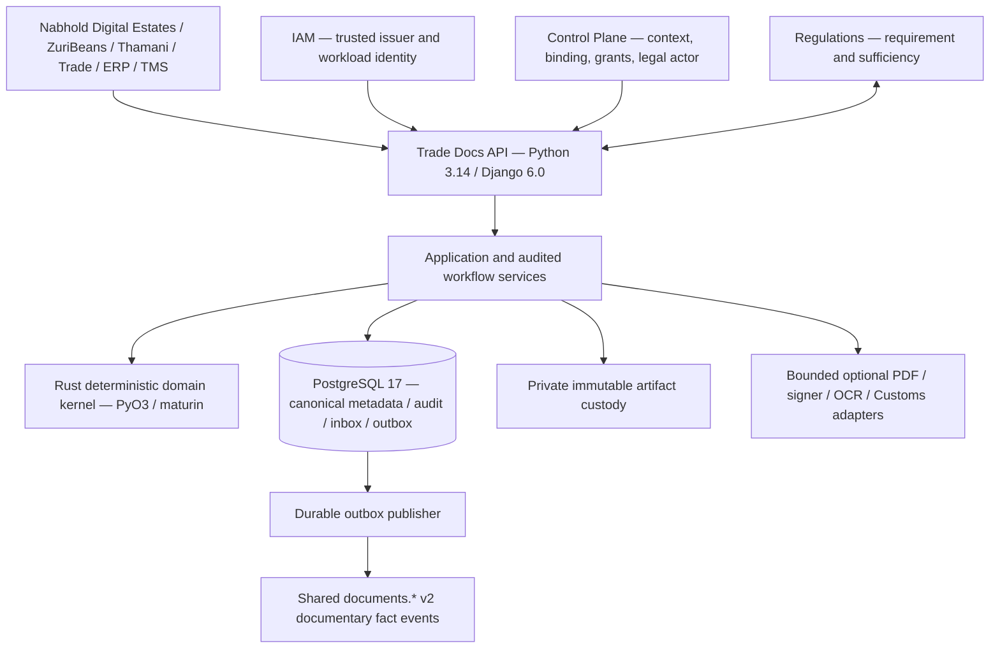
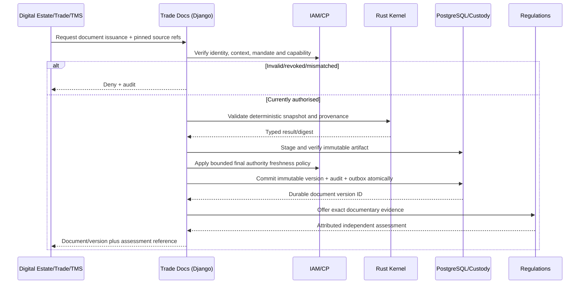

# TDOC-TECH-02 — Accepted Python/Rust Hybrid Architecture for Baobab Trade Docs

**Status:** Accepted (architecture only)  
**Decision date:** 2026-10-26  
**Repository:** `baobab-platform/baobab-trade-docs`  
**Implementation qualification:** NOT YET QUALIFIED  
**Supersession:** Supersedes TDOC-TECH-01 **only** for runtime technology choice and composition; preserves its compatible reasoning. Does not override Accepted ADR-TDOC-0001/0002 or Shared contracts.  
**Decision authority:** Baobab Platform architecture programme; status Accepted by platform owner on 2026-10-26.

## 1. Binding architectural decision

Baobab Trade Docs SHALL be one Baobab-owned, headless, modular trade-document engine using **Python 3.14, Django 6.0, Rust through PyO3/maturin, PostgreSQL 17 and private approved object storage**. Python owns the API, command orchestration, transactions and integrations; Rust is a deliberately narrow, deterministic, in-process validation/integrity kernel; PostgreSQL is the authoritative durable database. Rust SHALL NOT create a second canonical authority or independent application. External document conversion, electronic signing, scanning, OCR and national Customs integrations are optional isolated adapters, qualified independently.

This decision deliberately **does not** adopt Mayan EDMS, Paperless-ngx, Alfresco or another headless EDMS as the canonical documentary engine. Commodity components must be evaluated on licence, total cost, maintainability, operational complexity and measurable benefit. One engine is an **authority boundary**, not a requirement to deploy a collection of applications.

**Normative precedence:** (1) Accepted Shared EA v2.3 and Shared ADR-SHARED-019..024/026 as applicable; (2) Accepted ADR-TDOC-0001/0002; (3) locked canonical Shared `trade-document/v2`, `cross-engine-reference/v1`, `regulatory-document-exchange/v1`, `regulatory-document-evidence/v1`, event envelope and authority contracts; (4) this Accepted technology decision; (5) individually Proposed TDOC-0003..0019 only as design candidates until separately accepted. This decision does not grant additional event stewardship, capability bindings, national Customs privileges or production approval.

**Status semantics:** Accepted architectural choice is NOT implementation, legal accreditation, activated provider, successful runtime testing or evidence of deployed service. Conformance maturity remains `ARCHITECTURE_ONLY` until verifiable code and tests justify a change.

## 2. Strategic purpose, objectives and exclusions

**Mission:** Make African and intercontinental cross-border trade documentary processes accessible, verifiable, secure and interoperable, while faithfully recording the distinct authority of issuers, buyers, suppliers, carriers, customs agencies and regulators.

**Objectives:**
1. Issue exact, immutable, attributable trade-document versions and independently verify content integrity.
2. Support SMEs, ZuriBeans B2B UG/ZA trading, Thamani logistics, future clients and new corridors via reusable capabilities rather than estate-specific forks.
3. Preserve the distinction between issuer assertion, extracted observations, external normalization and generated information.
4. Provide version-pinned evidence to Regulations for independent applicability and sufficiency decisions; never claim Regulations decisions as Trade Docs decisions.
5. Link documentary versions to authoritative Trade, ERP and TMS facts without duplicating their commercial, accounting or movement authority.
6. Permit jurisdiction-specific document type profiles, mappings, disclosure policies, language requirements and channels, each versioned and independently qualified.
7. Provide deterministic security and custody properties, bounded retries, recoverable workflows and transparent evidence for audit.
8. Use low-bandwidth-friendly asynchronous interfaces and resumable document ingestion where practicable.

**Initial non-goals:** universal Customs connectivity, automatic Customs clearance, generic legal recognition of electronic bills of lading, unaudited AI-originated legal assertions, general-purpose EDMS collaboration, sovereign certificate issuance, or replacement of CP/IAM/ERP/Trade/TMS/Regulations.

## 3. Logical architecture

**Deployment:** one primary API application and optionally a separate worker process from the same versioned source/build. The Rust kernel is a native wheel, not a network microservice. Provider isolation may warrant an external subprocess/worker, but no provider may create another canonical TradeDocument authority.

## 4. Canonical authority boundaries

| Subject | Authoritative actor | Trade Docs contract |
|---|---|---|
| Tenant, Organisation, legal entity, capability, grants | Control Plane | Redeem trusted context; never infer tenant from request headers |
| Human/workload token, issuer and revocation | IAM, with CP principal/context governance | Validate issuer, signature, audience, subject, scope, time and current lifecycle |
| Documentary identity, version, lifecycle, verification | Trade Docs | Mint opaque IDs; maintain independent lifecycle, verification and validity axes |
| Document artifact integrity/custody | Trade Docs | Retain exact digest, length, key version, protected object ref and legal hold |
| Commercial values/accounting | Trade and/or ERP | Versioned source reference and attributed representation only |
| Movement/consignment/proof-of-delivery | TMS | Documentary reference to source facts only |
| Applicable requirements/legal sufficiency | Regulations | Pinned requirement and independent assessment, not local sufficiency assertion |
| Customs acceptance, refusal, release or seizure | Competent national authority | Authenticated, attributable external response only |
| Risk/extraction suggestions | Pulse / qualified provider | Mark inferred or extracted, never elevate to issuer authority |

Preserve `TradeDocument != DocumentVersion != ContentArtifact`; documentary lifecycle != verification != temporal validity; requirement != document; document ID != CP CanonicalEntity ID; an offer of documentary evidence != Regulations acceptance; Regulations assessment != Customs clearance.

## 5. Python/Rust admission and ABI contract

**Python SHALL own:** HTTP/ASGI, API validation, IAM/CP transport, transaction boundaries, Django migrations, provider ports, stateful application commands, policy freshness, error mapping, audit/outbox and workflow orchestration. Critical synchronous Django transactions SHALL be wrapped using the supported transactional execution pattern; async views must not silently assume async ORM transactions are supported.

**Rust SHALL own only bounded pure operations where justified:** deterministic state-transition checks; domain typed-reference validation; provenance/integrity rules; explicitly specified canonical representation and hashing; optionally qualified cryptographic verification and parser validation. Rust MUST NOT fetch CP authority, issue tokens, call remote services, write the DB, publish events or decide legal/regulatory sufficiency.

**FFI requirements:** versioned inputs/outputs; immutable typed values; structured denial/error codes; explicit input and output limits; deterministic fixtures; bounded CPU/memory; panics contained and mapped appropriately; forbid accidental unbounded memory or recursion from attacker-controlled input. Prefer narrow APIs to object graphs shared across runtime boundaries. Test process-level failures. A native module **is not** a sandbox; hostile-format decoding SHALL be isolated in hardened workers when warranted.

**Reproducible packaging:** pin Python interpreter, Rust toolchain, `pyo3`, `maturin`, dependency graph, build container, and hashes; build/test wheels for selected target CPU architectures and selected Python 3.14 ABI; qualify any `abi3` or free-threaded mode explicitly rather than assuming compatibility. Produce SBOM and dependency/security/licence evidence. Build must work cold in CI and Codespaces.

**Reuse:** Keep existing Python reference legal-actor issuance and exact Shared wire validators as independently maintained conformance oracles. Differential golden-vector tests compare the reference against Rust where applicable, without allowing the two to become competing production policy authorities.

## 6. PostgreSQL 17 durability and immutable custody

1. Document ID is Trade Docs-minted and opaque. Store separate document, immutable version, artifact manifest, typed association, provenance, issuer decision, audit and event-outbox records.
2. Enforce immutability using database privileges, constraints and reviewed immutable-row mechanisms; reject direct SQL updates/deletes by application credentials. A correction is a new version or new instrument according to governed document-type policy.
3. Enforce tenant/Organisation scope at application AND persistence access boundaries. Consider row-level security as defense in depth, with documented role/connection-pool behaviour and leakage tests.
4. An issuance commit SHALL atomically persist document/version, append-only audit and outbox event in one PostgreSQL transaction. Publisher is **at least once**; consumers deduplicate event IDs and respect causal ordering. Never claim distributed ACID.
5. Enforce idempotency keys scoped by actor/tenant/operation/canonical-payload-hash. Replays with mismatched payloads deny, duplicate retries return original committed results.
6. Concurrency control includes row locks or optimistic revision fencing. The final commit fence rechecks the freshness and applicable bounds of mandate/CP evidence; remote revocation cannot be made atomic with a DB transaction. Document the race window and deny on stale/unknown authority.
7. Object storage and PostgreSQL cannot be one atomic transaction: stage upload; malware/type/length/checksum screen; record digest and immutable custody evidence; reconcile orphaned/missing objects; publish issued facts only once custody is durable and verified.
8. Preserve occurrence/effective time, observation time, external-authority decision time and receipt time separately when historically relevant; do not rewrite prior decisions.

## 7. Security, residency, disclosure and legal guardrails

- Fail closed on invalid/expired/wrong-audience/revoked IAM token, unknown issuer, unapproved legal actor, stale capability, wrong tenant, revoked representative, inappropriate Market or absent mandate.
- Never rely on caller-supplied tenant, legal entity, country, market, issuer, actor, permission or decision timestamp as a substitute for CP-backed evidence.
- For privileged document issuance, complete authenticated CP-bound legal-actor assessment, lease/freshness enforcement and final reassessment; retain causal evidence of the exact decision and policy revision.
- Use encrypted private artifact storage, TLS, key rotation, digest verification, malware filtering, purpose-bound access, short-lived retrieval grants, protected logs, retention schedules, legal holds and separately authorised inter-Organisation disclosure.
- Apply POPIA and jurisdiction-specific requirements for transfer, residency, privacy and disclosure **per corridor and data category**. Do not claim blanket continent-wide adequacy.
- Electronic signatures are not equivalent to legal issuer permission. A PDF is not by itself an electronic transferable record; exclusive control and applicable legal/scheme requirements matter. A Customs declaration does not become accepted merely because an adapter submitted it.
- External responses require authenticated endpoint binding, replay defenses, recorded signature/source evidence where available and idempotent reconciliation; no fabricated Customs confirmation.
- AI/OCR observations maintain `ISSUER_ASSERTED`, `BAOBAB_EXTRACTED`, `BAOBAB_GENERATED`, `EXTERNAL_NORMALIZED` provenance axes, with review/attestation required where a legally material assertion is derived.

## 8. Cross-border corridor and documentary interoperability

A corridor-specific qualification profile SHALL pin origin, destination, transit jurisdictions, movement mode, goods classifications, dates/effective law, parties, document type version, applicable Rules/Regulations decision revision and permitted national channels. Trade Docs does not determine the legal applicability of a permit requirement: Regulations does.

| Example | Documentary functions | Boundaries |
|---|---|---|
| Uganda → South Africa coffee and vanilla for ZuriBeans | Invoice, packing list, origin/quality evidence, transport records, exact version references | Tariffs, certificates and country/commodity restrictions resolved by Regulations/competent agencies |
| Thamani multi-market logistics | Consignment/waybill representations, carrier documents, delivery evidence | TMS owns physical shipment and POD facts |
| Buyer/supplier document sharing | Authorised per-recipient disclosure and pinned versions | CP tenant/relationship, legal basis, consent where required |
| Customs lodgement | Versioned national-gateway adapter, simulated qualification | Real filing blocked until accreditation, credentials and jurisdiction proof |
| eBL/electronic transferable record | Governed future typed capability | No exclusivity, possession, title or legal-recognition claim without proven legal/scheme controls |

For interoperability, study/map the **WCO Data Model**, **UN/CEFACT Buy–Ship–Pay** and relevant versioned national specifications. These are not one universal Customs API, and national/sector-specific requirements take precedence. Profile, mapping and schema revisions must be pinned, tested and historically resolvable.

## 9. Implementation programme: TDOC-HYB-00 through TDOC-HYB-07

| Gate | Scope | Exact minimum exit proof |
|---|---|---|
| HYB-00 | Adopt decision and reconcile register/locks | Accepted ADR, previous Proposed status preserved as history, RTD-10 `ARCHITECTURE_ONLY` unchanged |
| HYB-01 | Python 3.14 / Django 6 / Rust / PyO3 / maturin / PostgreSQL 17 runtime | Pinned toolchain, cold devcontainer build, Linux wheel import, migrations, security/licence scan |
| HYB-02 | Rust deterministic kernel and Python callable boundary | Exact Shared v2 wire vectors, independent reference differential tests, malformed-input denials, property/fuzz and ABI matrix |
| HYB-03 | Documentary models, immutable PostgreSQL versions and content custody | Real DB direct-SQL bypass negatives, concurrent issuance, immutable content, orphan/recovery cases |
| HYB-04 | Live IAM/CP issuer and capability fence | Real token validity, wrong audience/tenant, revoked representative, absent grant and stale mandate negatives |
| HYB-05 | Durable outbox/inbox and regulatory documentary exchange | Atomic DB event/audit, duplicate command replay, unchanged RTD-06 shapes and source-provenance assertions |
| HYB-06 | Cross-engine UG→ZA synthetic dossier | Governed ZuriBeans/Thamani fixture, pinned Trade/ERP/TMS source facts, independent Regulations assessment |
| HYB-07 | Protected readiness/operational certification | Independent approval, measured performance/RPO/RTO, recovery, key rotation, isolation and provider/corridor qualification |

Every gate SHALL provide source, tests, version pins, CI run, evidence hashes, negative cases and cleanup/teardown where applicable. Where a gate requires real IAM/CP or PostgreSQL, mocked conformance does not count. Development may use CP-governed synthetic fixtures, but **protected staging/production require independent approval**. No policy-positive case may be gained by changing previously accepted negative expectations.

## 10. Measurable nonfunctional requirements

**Correctness:** all declared positive and negative acceptance vectors pass; all cross-tenant, stale-authority and unauthorised operations deny; direct-SQL version edits fail under application credentials.  
**Durability:** no issued fact absent committed audit/outbox; no accepted version absent verified durable artifact custody; retries and crashes do not duplicate issuance.  
**Reproducibility:** pinned dependency closure, source and binary provenance, SBOM, deterministic Shared lock and test matrix.  
**Performance:** define API/ingest/render/external-provider p95 and throughput from measured workloads including constrained African networks; do not fabricate targets before representative benchmarks.  
**Recovery:** test restore, stuck outbox, orphan artifacts, retention/key rotation and revoked download; record measured RPO/RTO.  
**Accessibility:** async status endpoints, upload resumability, cautious payload limits and low-bandwidth design.

## 11. Principal risks and mitigations

| Risk | Control |
|---|---|
| Polyglot maintenance burden | Small versioned Rust FFI; preserve Python orchestration; one build and release |
| Native Python ABI drift | Pinned wheel matrix and cold import/packaging tests; no unqualified free-threaded build |
| Authority confusion between engines | Strict CP/IAM, Regulations, issuer, Customs and Trade Docs boundaries |
| Mutable versions or copied storage references | DB-level immutability + content checks + immutable object custody |
| DB/object-store partial failure | Durable staging/finalization, reconciliation and delayed fact publication |
| Country-specific legal/regulatory change | Versioned corridor packs, effective law reference, independently owned Regulations decision |
| Data leak across client organisations or Markets | Purpose/relationship-aware CP resolution, least-privilege custody and recipient disclosure enforcement |
| AI/OCR provenance escalation | Separate assertion classes, explicit issuer validation and human attestation when required |
| Unexpected EDMS/vendor complexity | No second document system of record, adapters only |

## 12. Supersession, references and implementation caution

TDOC-TECH-02 is **Accepted as the permanent architectural baseline** (subject to a future explicit accepted superseding ADR). It supersedes TDOC-TECH-01's **Proposed** technology-selection portion; compatible guidance remains informative. ADR-TDOC-0003..0019 remain Proposed until accepted one by one. Shared v2 contract authority is unchanged. RTD-10 maturity remains `ARCHITECTURE_ONLY` until true runtime source/tests pass.

**References / engineering research (reviewed 2026-10-26):**
- Django 6.0 release/Python compatibility: https://docs.djangoproject.com/en/6.0/releases/6.0/
- Django PostgreSQL backend and transaction guidance: https://docs.djangoproject.com/en/6.0/ref/databases/ and https://docs.djangoproject.com/en/6.0/topics/async/
- Psycopg 3: https://www.psycopg.org/psycopg3/docs/
- PyO3 supported Python and packaging: https://pyo3.rs/ and https://pyo3.rs/main/building-and-distribution
- maturin: https://www.maturin.rs/
- PostgreSQL 17: https://www.postgresql.org/docs/17/
- WCO Data Model: https://www.wcoomd.org/DataModel
- UN/CEFACT: https://unece.org/trade/uncefact
- UNCITRAL Model Law on Electronic Transferable Records and enactment: https://uncitral.un.org/en/texts/ecommerce/modellaw/electronic_transferable_records
- Baobab normative records: Accepted Shared EA v2.3, Shared ADR-SHARED-019..024/026, local ADR-TDOC-0001/0002, RTD-04 through RTD-10, Shared immutable lock `a9c53087d63caa356edf54ec8037ba1713c4827f`, and P0-04A issuer reference.

**Evidence boundary:** Published framework documentation supports individual technologies, but is NOT a claimed successful integrated Python/Rust/PostgreSQL build or national Customs authorization. Those are implementation-gate obligations.
